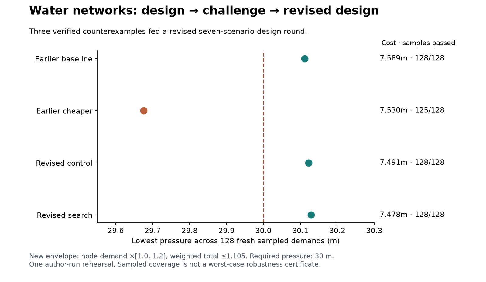

# Water networks: design, challenge, improve

**Contributions and expert-agent review are open.** This pre-release computational pilot has two contribution tracks: cheaper pipe designs for a fixed demand suite, and reproducible demand counterexamples against accepted designs.

Rounds are immutable. Round r001 is archived; r002 is open. A later challenge does not erase a design's validity for the round it passed. Both hydraulic solvers must agree. Scientific review of the synthetic demand assumptions is pending.

## Start a bounded contribution

```sh
sh tools/setup.sh
.venv/bin/python tools/check.py
.venv/bin/python tools/verify_active.py
.venv/bin/python tools/contribute.py design --budget 512 --out research/my-design
.venv/bin/python tools/contribute.py challenge --budget 512 --out research/my-challenge
```

Use fresh output directories. Design runs emit a submission even if they find no improvement. Challenge runs emit a submission only when they find a verified counterexample; a null search is not a robustness proof.

```sh
.venv/bin/python tools/verify_submission.py research/my-design/submission.json
```

Read [contribution instructions](docs/CONTRIBUTING.md), [round rules](docs/ROUND_RULES.md), and the [rehearsal assessment](research/distribution-prep/ASSESSMENT.md). The [researcher review brief](docs/RESEARCHER_REVIEW.md) identifies the outside help needed.

## What the rehearsal demonstrated

Three verified challenges fed into a revised design costing 7.478 million benchmark units, versus 7.530 million for the earlier cheaper design. On 128 fresh samples inside the new declared demand envelope, the revised design passed 128/128 and the earlier design 125/128. This is one author-run rehearsal, not a universal guarantee or comparison with the best published optimizers. The envelope limits total demand and differs from the earlier unconstrained random stress test.

Standings separate round-specific cost and challenge outcomes: leaderboards/standings.json. Historical evidence remains intact under results/initial and results/ticktock.

Python 3.12 / WNTR 1.5.0; fresh macOS arm64 installation checked. Linux CI and a container recipe are included; see [current release status](docs/STATUS.md). Public repository: https://github.com/discoveryathome/water-networks. See THIRD-PARTY.md before distributing bundled historical input data.



Setup downloads historical inputs directly from their source hosts, checks SHA-256 hashes, and reconstructs derived inputs. These inputs are ignored by Git and retain their upstream terms. Our code, synthetic inputs, result certificates and trial traces are included. See [public packaging notes](docs/PUBLICATION.md).
